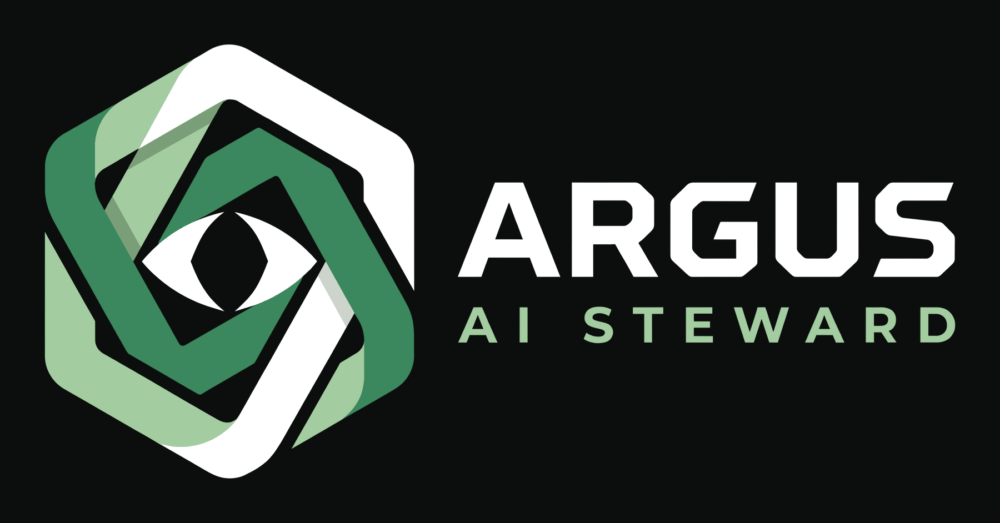
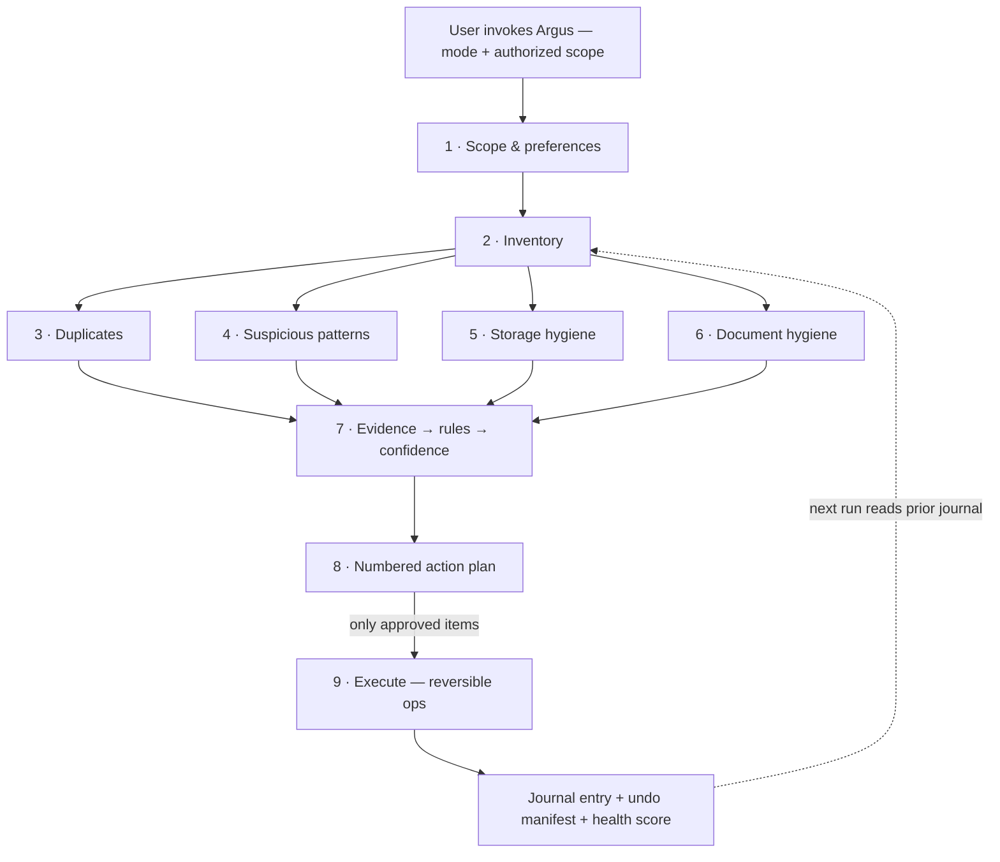

<div align="center">

<picture>
  <source media="(prefers-color-scheme: dark)" srcset="assets/brand/argus-logo-dark.png">
  <source media="(prefers-color-scheme: light)" srcset="assets/brand/argus-logo-light.png">
  
</picture>

**The hundred-eyed steward for your UGREEN AI NAS**

Audits · proposes · waits for your yes · remembers everything

[](LICENSE)
[](argus/SKILL.md)
[](proposal/argus-proposal.md)
[](argus/)

</div>

---

## What is Argus?

**Argus** is a conversational AI steward for UGREEN AI NAS, built as a Markdown-only [Uliya Skill](argus/SKILL.md). Named after Argus Panoptes — the hundred-eyed guardian of Greek myth — it watches over your storage the way a good steward watches over a house.

Point it at a folder and Argus audits it across five checks — **duplicates, suspicious patterns, storage waste, disorganization, and document hygiene** — then presents one numbered action plan. Nothing moves without your approval. Every run is journaled, scored, and reversible.

> **Entry for the [UGREEN Hackathon 2026 on AI NAS](https://ugreenhackathon.devpost.com) — Open Innovation track.**

## Why it is different

Most NAS skills are stateless: they do one job and forget. Argus is **stateful**:

| Capability | What it means |
|---|---|
| **Journal + diff** | Every run writes a dated entry; `what-changed` compares any two runs |
| **Undo manifest** | Each mutation records source → destination; `revert` restores the last run |
| **Health score** | Deterministic 0–100 score from the same rules every time — comparable across runs |
| **Preferences** | Persistent watchlist: paths never to touch, naming conventions, thresholds |
| **Review buckets** | Low-confidence findings route to human review instead of silent action |

## How it works



Argus orchestrates six registered expert agents over nine published CLI families (capability catalog v2.0.0) — the parent skill never touches the filesystem directly; it delegates self-contained tasks through `delegate` commands and applies **deterministic rules over collected evidence**, so verdicts are explainable and reproducible.

## Modes

| Mode | One line |
|---|---|
| `full-audit` | The complete nine-phase pipeline |
| `quick-sweep` | Fast hygiene pass: duplicates, temp files, suspicious patterns |
| `file-this` | Propose destination + name for new or stray files |
| `what-changed` | Diff against the previous journal entry |
| `report` | Health score + dashboard, no mutations |
| `revert` | Undo the last executed run from its manifest |
| `prefs` | Show or update the persistent watchlist/preferences |
| `watch` | Correlate file activity with surveillance events |

## Repository layout

```
argus/                  ← the skill package (this is the product)
  SKILL.md              ← entry point: goal, inputs, workflow, completion
  references/           ← 7 linked docs: capabilities, heuristics, protocol,
                          journal format, user guide, test plan, disclosures
proposal/               ← Round 1 proposal source (md → docx → pdf)
deliverable-r1/         ← frozen Round 1 artifacts (zip + pdf + manifest)
submission-r1/          ← exact copy of the submitted skill zip
test-data/messy-scope/  ← synthetic fixture: one trigger per heuristic rule
tools/                  ← docx generator for the proposal
assets/brand/           ← logo variants
```

## Validation

```bash
node uliya-skill-kit/scripts/check-skill.mjs argus
# → static-pass · 0 errors · 0 warnings
```

Package limits: 8 files · 13.8 KB zipped · Markdown only · no scripts, binaries, credentials, or placeholders.

## Principles

- **Propose, never impose** — every mutation is a numbered plan item awaiting approval
- **Read-only by default** — inventory and analysis change nothing
- **Reversible actions** — moves over deletes; undo manifest on every run
- **Honest screening** — heuristic flags for human review, never antivirus claims
- **Local-first** — no external transfer of file contents or personal data

## Documentation

- Skill entry point: [argus/SKILL.md](argus/SKILL.md)
- Capability map: [argus/references/capability-map.md](argus/references/capability-map.md)
- Heuristics: [argus/references/heuristics.md](argus/references/heuristics.md)
- Conversation protocol: [argus/references/conversation-protocol.md](argus/references/conversation-protocol.md)
- Journal format: [argus/references/journal-format.md](argus/references/journal-format.md)
- Test plan: [argus/references/test-plan.md](argus/references/test-plan.md)
- AI-tooling & license disclosures: [argus/references/disclosures.md](argus/references/disclosures.md)

## License

[MIT](LICENSE) © 2026 Helmut Chaparro Sandoval
