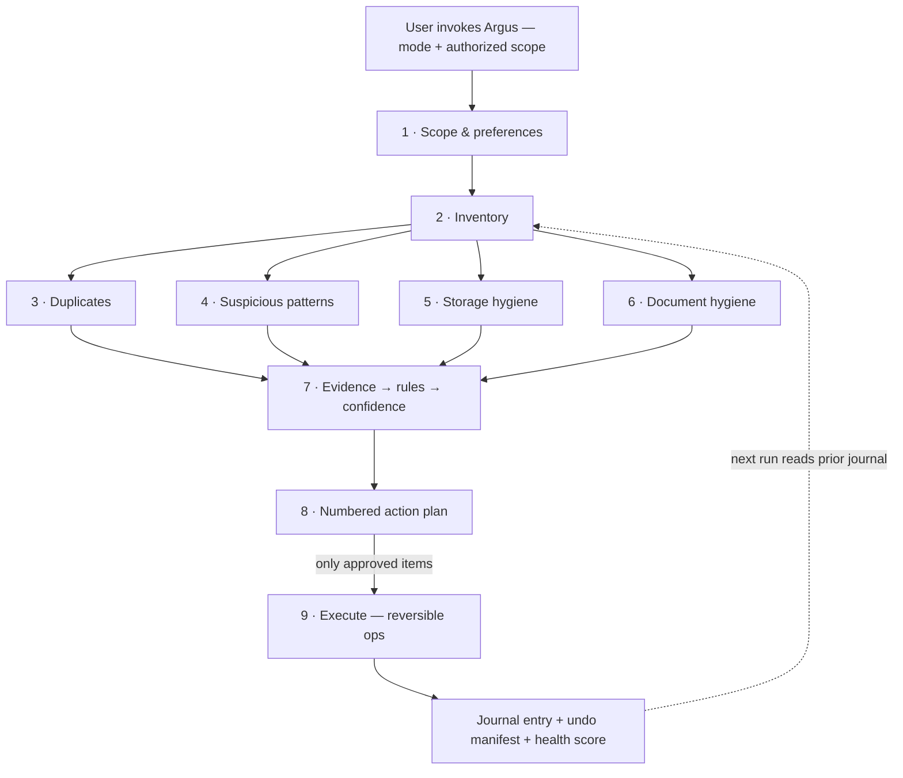

<div align="center">


**[What it is](#what-is-argus) · [Why different](#why-it-is-different) · [How it works](#how-it-works) · [Modes](#modes) · [A run looks like](#how-a-run-looks) · [Validation](#validation) · [Docs](#documentation) · [License](#license)**

</div>

---

## What is Argus?

**Argus** is a conversational AI steward for UGREEN AI NAS, built as a Markdown-only [Uliya Skill](argus/SKILL.md). Named after Argus Panoptes — the hundred-eyed guardian of Greek myth — it watches over your storage the way a good steward watches over a house.

Point it at a folder and Argus audits it across five checks — **duplicates, suspicious patterns, storage waste, disorganization, and document hygiene** — then presents one numbered action plan. Nothing moves without your approval. Every run is journaled, scored, and reversible.

> **Entry for the [UGREEN Hackathon 2026 on AI NAS](https://ugreenhackathon.devpost.com) — Open Innovation track.**

## Why it is different

Most NAS skills are stateless: they do one job and forget. Argus is **stateful**:

| Capability | What it means |
|---|---|
| **Journal + diff** | Every run writes a dated entry; `what-changed` compares any two runs |
| **Undo manifest** | Each mutation records source → destination; `revert` restores the last run |
| **Health score** | Deterministic 0–100 score from the same rules every time — comparable across runs |
| **Preferences** | Persistent watchlist: paths never to touch, naming conventions, thresholds |
| **Review buckets** | Low-confidence findings route to human review instead of silent action |

## How it works



Argus orchestrates six registered expert agents over nine published CLI families (capability catalog v2.0.0) — the parent skill never touches the filesystem directly; it delegates self-contained tasks through `delegate` commands and applies **deterministic rules over collected evidence**, so verdicts are explainable and reproducible.

## Modes

| Mode | One line |
|---|---|
| `full-audit` | The complete nine-phase pipeline |
| `quick-sweep` | Fast hygiene pass: duplicates, temp files, suspicious patterns |
| `file-this` | Propose destination + name for new or stray files |
| `what-changed` | Diff against the previous journal entry |
| `report` | Health score + dashboard, no mutations |
| `revert` | Undo the last executed run from its manifest |
| `prefs` | Show or update the persistent watchlist/preferences |
| `watch` | Correlate file activity with surveillance events |

## Repository layout

```
argus/                  ← the skill package (this is the product)
  SKILL.md              ← entry point: goal, inputs, workflow, completion
  references/           ← 7 linked docs: capabilities, heuristics, protocol,
                          journal format, user guide, test plan, disclosures
proposal/               ← Round 1 proposal source (md → docx → pdf)
deliverable-r1/         ← frozen Round 1 artifacts (zip + pdf + manifest)
submission-r1/          ← exact copy of the submitted skill zip
test-data/messy-scope/  ← synthetic fixture: one trigger per heuristic rule
tools/                  ← docx generator for the proposal
assets/brand/           ← logo variants
```

## How a run looks

> **You:** Argus, full audit of Downloads.
>
> **Argus:** Scanning authorized scope — 1,847 files inventoried.
> Found: 3 duplicate groups (214 MB recoverable), 2 flagged items for review, 41 large files older than 18 months.
>
> **Action plan** — 6 items proposed:
> 1. Merge duplicate group `photo-2024-beach` (keep the higher-resolution copy)
> 2. Move `report.pdf.exe` to quarantine — double extension, review required
> 3. Archive 12 installers older than 2 years
> …
>
> **You:** approve 1–3
>
> **Argus:** Done — 3/6 executed, 2 skipped, 1 awaiting input. Journal entry `2026-11-06T14-32` written with undo manifest. Health score: **78 → 86**. Say `revert` to roll back.

Everything in the dialogue is grounded in catalog evidence — Argus never invents results, and a plan without your approval changes nothing.

## Validation

```bash
node uliya-skill-kit/scripts/check-skill.mjs argus
# → static-pass · 0 errors · 0 warnings
```

Package limits: 8 files · 13.8 KB zipped · Markdown only · no scripts, binaries, credentials, or placeholders.

## Principles

- **Propose, never impose** — every mutation is a numbered plan item awaiting approval
- **Read-only by default** — inventory and analysis change nothing
- **Reversible actions** — moves over deletes; undo manifest on every run
- **Honest screening** — heuristic flags for human review, never antivirus claims
- **Local-first** — no external transfer of file contents or personal data

## Documentation

- Skill entry point: [argus/SKILL.md](argus/SKILL.md)
- Capability map: [argus/references/capability-map.md](argus/references/capability-map.md)
- Heuristics: [argus/references/heuristics.md](argus/references/heuristics.md)
- Conversation protocol: [argus/references/conversation-protocol.md](argus/references/conversation-protocol.md)
- Journal format: [argus/references/journal-format.md](argus/references/journal-format.md)
- Test plan: [argus/references/test-plan.md](argus/references/test-plan.md)
- AI-tooling & license disclosures: [argus/references/disclosures.md](argus/references/disclosures.md)

## License

[MIT](LICENSE) © 2026 Helmut Chaparro Sandoval — AI-tooling disclosure in [disclosures.md](argus/references/disclosures.md)

---

<div align="center">


**ARGUS** — propose, never impose · evidence decides · every move leaves a receipt

<sub>Built for the UGREEN Hackathon 2026 on AI NAS · Bogotá D.C., Colombia · © 2026 Helmut Chaparro Sandoval</sub>

</div>
